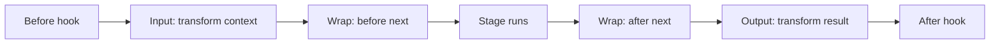

Middleware is a mechanism for wrapping stages of an agent to influence or change how the agent executes. A middleware handler can transform what goes into a model call or tool execution, transform what comes back, or wrap the whole operation to retry it, cache it, reroute it, or skip it entirely.

Reach for middleware when you need to control the flow of a stage, and use [hooks](/docs/user-guide/sdk/agents/hooks/index.md) to observe and react to lifecycle events. Middleware is the right tool when you want to wrap a stage and decide whether, and how many times, it runs: retry on a throttle, serve a cached response, or hold a tool call for human approval.

## Stages and phases

A stage is an interception point in the agent run. Each stage has a context (what goes in) and a result (what comes back), and its handlers can transform either one.

### Available stages

(( tab "Python" ))
| Stage | Wraps | Context | Result |
| --- | --- | --- | --- |
| [`InvokeModelStage`](/docs/api/python/strands.middleware.stages#InvokeModelStage) | A single model call | [`InvokeModelContext`](/docs/api/python/strands.middleware.stages#InvokeModelContext) | [`InvokeModelResult`](/docs/api/python/strands.middleware.stages#InvokeModelResult) |
| [`ExecuteToolStage`](/docs/api/python/strands.middleware.stages#ExecuteToolStage) | A single tool call | [`ExecuteToolContext`](/docs/api/python/strands.middleware.stages#ExecuteToolContext) | [`ExecuteToolResult`](/docs/api/python/strands.middleware.stages#ExecuteToolResult) |
(( /tab "Python" ))

(( tab "TypeScript" ))
| Stage | Wraps | Context | Result |
| --- | --- | --- | --- |
| [`InvokeModelStage`](/docs/api/typescript/InvokeModelStage/index.md) | A single model call | [`InvokeModelContext`](/docs/api/typescript/InvokeModelContext/index.md) | [`InvokeModelResult`](/docs/api/typescript/InvokeModelResult/index.md) |
| [`ExecuteToolStage`](/docs/api/typescript/ExecuteToolStage/index.md) | A single tool call | [`ExecuteToolContext`](/docs/api/typescript/ExecuteToolContext/index.md) | [`ExecuteToolResult`](/docs/api/typescript/ExecuteToolResult/index.md) |
(( /tab "TypeScript" ))

Tool execution also supports [human-in-the-loop interrupts](#gating-tool-execution-on-human-approval).

### Phases

Each stage exposes three phases, and every phase runs in the same fixed order no matter what order you register handlers in:

-   **Input** transforms the context before the stage runs.
-   **Wrap** is the full wrap: the handler receives the context and a `next` function, and decides when (and whether) to call it. Calling `next` zero times short-circuits the stage, once passes it through, and more than once retries it.
-   **Output** transforms the result after the stage runs. The handler receives and returns the stage’s result type (`InvokeModelResult` or `ExecuteToolResult`).

Input transforms the context, Wrap wraps the stage (whose work runs inside it), and Output transforms the result on the way back out.



## Middleware registration

Register a handler with `agent.add_middleware()``agent.addMiddleware()`, passing a stage token for the Wrap phase or a phase sub-token for a pure transform.

Transform the context before the model runs with the Input phase:

(( tab "Python" ))
```python
from strands import Agent
from strands.middleware import InvokeModelStage

agent = Agent()

def be_concise(context):
    return context.replace(system_prompt="Be concise.")

agent.add_middleware(InvokeModelStage.Input, be_concise)
```

Treat the context as immutable: use its `replace()` method to produce a modified copy rather than mutating it in place.
(( /tab "Python" ))

(( tab "TypeScript" ))
```typescript
import { Agent, InvokeModelStage } from '@strands-agents/sdk'

const agent = new Agent()

agent.addMiddleware(InvokeModelStage.Input, (context) => ({
  ...context,
  systemPrompt: 'Be concise.',
}))
```

The context is read-only, so return a modified copy with object spread rather than mutating it in place.
(( /tab "TypeScript" ))

The new prompt applies to this model call only. `agent.system_prompt``agent.systemPrompt` is unchanged, so the next call starts from it again.

Transform the result after the model runs with the Output phase:

(( tab "Python" ))
```python
from strands import Agent
from strands.middleware import InvokeModelStage

agent = Agent()

def log_stop_reason(result):
    print(f"model stopped with reason {result.result.stop_reason}")
    return result

agent.add_middleware(InvokeModelStage.Output, log_stop_reason)
```
(( /tab "Python" ))

(( tab "TypeScript" ))
```typescript
import { Agent, InvokeModelStage } from '@strands-agents/sdk'

const agent = new Agent()

agent.addMiddleware(InvokeModelStage.Output, (result) => {
  console.log(`model stopped with reason ${result.result.stopReason}`)
  return result
})
```
(( /tab "TypeScript" ))

For full control, register a Wrap handler on the bare stage token. It is an async generator: stream events through, and hand back the stage result as the generator’s final value.

(( tab "Python" ))
```python
import time
from strands import Agent
from strands.middleware import InvokeModelStage

agent = Agent()

async def timing(context, next_fn):
    start = time.monotonic()
    async for event in next_fn(context):
        yield event
    print(f"model call took {time.monotonic() - start:.2f}s")

agent.add_middleware(InvokeModelStage, timing)
```

An async generator cannot return a value, so the stage result is an event in the stream: a [`ModelStopReason`](/docs/api/python/strands.types.events#ModelStopReason) for a model call, a [`ToolResultEvent`](/docs/api/python/strands.types.events#ToolResultEvent) for a tool call. The agent picks it out by type, so a handler may yield its own events before or after it.
(( /tab "Python" ))

(( tab "TypeScript" ))
```typescript
import { Agent, InvokeModelStage } from '@strands-agents/sdk'

const agent = new Agent()

agent.addMiddleware(InvokeModelStage, async function* (context, next) {
  const start = Date.now()
  const result = yield* next(context)
  console.log(`model call took ${Date.now() - start}ms`)
  return result
})
```

The result is the value the generator returns via `yield* next(context)`. Registration returns a cleanup function; call it to remove the handler.
(( /tab "TypeScript" ))

## Retrying, caching, and short-circuiting

The Wrap phase controls how often the stage runs, which is what makes retries, caches, and short-circuits possible. Call `next` again to retry:

(( tab "Python" ))
```python
import asyncio
from strands import Agent
from strands.middleware import InvokeModelStage
from strands.types.exceptions import ModelThrottledException

agent = Agent()

async def retry_on_throttle(context, next_fn):
    for attempt in range(3):
        try:
            async for event in next_fn(context):
                yield event
            return
        except ModelThrottledException:
            if attempt == 2:
                raise
            await asyncio.sleep(2 ** attempt)

agent.add_middleware(InvokeModelStage, retry_on_throttle)
```
(( /tab "Python" ))

(( tab "TypeScript" ))
```typescript
import { Agent, InvokeModelStage, ModelThrottledError } from '@strands-agents/sdk'

const agent = new Agent()

agent.addMiddleware(InvokeModelStage, async function* (context, next) {
  for (let attempt = 0; ; attempt++) {
    try {
      return yield* next(context)
    } catch (error) {
      if (!(error instanceof ModelThrottledError) || attempt >= 2) throw error
      await new Promise((resolve) => setTimeout(resolve, 2 ** attempt * 1000))
    }
  }
})
```
(( /tab "TypeScript" ))

This is an alternative to the agent’s [retry strategy](/docs/user-guide/sdk/agents/retry-strategies/index.md), which already retries throttled model calls with exponential backoff by default. If you use retry middleware instead, disable the strategy so the two don’t stack: the strategy runs outside the middleware chain, so each of its retries runs your middleware again.

To short-circuit, produce a result without calling `next`. A response cache does this: return the stored result on a hit, and only call the model on a miss.

(( tab "Python" ))
```python
import json
from strands import Agent
from strands.middleware import InvokeModelStage, ModelStopReason

agent = Agent()
response_cache = {}

async def cache_responses(context, next_fn):
    key = json.dumps(context.messages, default=str)
    if key in response_cache:
        yield response_cache[key]
        return

    async for event in next_fn(context):
        if isinstance(event, ModelStopReason):
            response_cache[key] = event
        yield event

agent.add_middleware(InvokeModelStage, cache_responses)
```

The `ModelStopReason` event is the model call’s result, so the cache stores that event and yields it back on a hit.
(( /tab "Python" ))

(( tab "TypeScript" ))
```typescript
import { Agent, InvokeModelStage } from '@strands-agents/sdk'
import type { InvokeModelResult } from '@strands-agents/sdk'

const agent = new Agent()
const responseCache = new Map<string, InvokeModelResult>()

agent.addMiddleware(InvokeModelStage, async function* (context, next) {
  const key = JSON.stringify(context.messages)
  const cached = responseCache.get(key)
  if (cached) return cached

  const result = yield* next(context)
  responseCache.set(key, result)
  return result
})
```
(( /tab "TypeScript" ))

## Routing a call to a different model

The model on the context is per-call and replaceable. Swap it in an Input handler to route a single call to a different model without touching agent state. The model you set also drives the model ID recorded on the call’s trace span. This routes oversized requests to a larger-context model:

(( tab "Python" ))
```python
from strands import Agent
from strands.middleware import InvokeModelStage
from strands.models import BedrockModel

agent = Agent()
large_context_model = BedrockModel(
    model_id="global.anthropic.claude-sonnet-4-6"
)

def route_by_size(context):
    if (context.projected_input_tokens or 0) > 50_000:
        return context.replace(model=large_context_model)
    return context

agent.add_middleware(InvokeModelStage.Input, route_by_size)
```
(( /tab "Python" ))

(( tab "TypeScript" ))
```typescript
import { Agent, InvokeModelStage, BedrockModel } from '@strands-agents/sdk'

const agent = new Agent()
const largeContextModel = new BedrockModel({
  modelId: 'global.anthropic.claude-sonnet-4-6',
})

agent.addMiddleware(InvokeModelStage.Input, (context) =>
  (context.projectedInputTokens ?? 0) > 50_000
    ? { ...context, model: largeContextModel }
    : context
)
```
(( /tab "TypeScript" ))

## Gating tool execution on human approval

Tool-execution middleware can pause a run and wait for a person, using the context’s `interrupt` method. The first call halts the agent with an [interrupt](/docs/user-guide/sdk/interrupts/index.md); when the caller resumes with a response, the same call returns it. Deny the call by returning an error result, or approve it by passing through to `next`.

(( tab "Python" ))
```python
from strands import Agent
from strands.middleware import ExecuteToolStage, ToolResultEvent

agent = Agent()

async def approval_gate(context, next_fn):
    approval = context.interrupt(
        "approve_tool", reason=f"Run {context.tool_use['name']}?"
    )
    if approval.response != "approved":
        yield ToolResultEvent({
            "toolUseId": context.tool_use["toolUseId"],
            "status": "error",
            "content": [{"text": "Denied by reviewer"}],
        })
        return
    async for event in next_fn(context):
        yield event

agent.add_middleware(ExecuteToolStage, approval_gate)
```
(( /tab "Python" ))

(( tab "TypeScript" ))
```typescript
import { Agent, ExecuteToolStage, ToolResultBlock, TextBlock } from '@strands-agents/sdk'

const agent = new Agent()

agent.addMiddleware(ExecuteToolStage, async function* (context, next) {
  const { response } = context.interrupt<string>({
    name: 'approve_tool',
    reason: `Run ${context.toolUse.name}?`,
  })

  if (response !== 'approved') {
    return {
      result: new ToolResultBlock({
        toolUseId: context.toolUse.toolUseId,
        status: 'error',
        content: [new TextBlock('Denied by reviewer')],
      }),
    }
  }
  return yield* next(context)
})
```
(( /tab "TypeScript" ))

## How middleware relates to hooks

Middleware and [hooks](/docs/user-guide/sdk/agents/hooks/index.md) both extend a running agent, and both can fire on the same stage. The difference is where they sit: hooks fire outside the middleware chain, wrapping it, and they work differently:

-   **Hooks always fire, even when middleware short-circuits.** A cache that returns without calling `next` still triggers the Before and After hooks for that stage, so anything counting calls sees the attempt.
-   **A retry produces one hook pair, not many.** Middleware that calls `next` three times is invisible to hooks, which only see the outermost call and result. If you need per-attempt observability, put that logic in middleware, not a hook.
-   **Hooks change agent state; middleware changes the call.** To give one model call a different system prompt from a hook, you set `agent.system_prompt``agent.systemPrompt` and restore it afterward. Middleware passes a modified context to `next`, and the agent’s own state is never touched.

Trace spans record post-middleware state: the model-invoke span captures the messages, system prompt, and model the call actually used, reflecting every transformation middleware applied on the way in.

## Related pages

- [Tool Executors](/docs/user-guide/sdk/tools/executors/index.md) (2 shared tags)
- [Agent Loop](/docs/user-guide/sdk/agents/agent-loop/index.md) (2 shared tags)
- [Hook events](/docs/user-guide/sdk/agents/hooks-events/index.md) (2 shared tags)
- [Hooks](/docs/user-guide/sdk/agents/hooks/index.md) (2 shared tags)
- [Interrupts](/docs/user-guide/sdk/interrupts/index.md) (2 shared tags)
- [Creating a Custom Model Provider](/docs/user-guide/sdk/model-providers/custom_model_provider/index.md) (1 shared tag)
- [Steering](/docs/user-guide/sdk/agents/interventions/steering/index.md) (2 shared tags)
- [Interventions](/docs/user-guide/sdk/agents/interventions/index.md) (2 shared tags)
- [Production Lifecycle Controls](/docs/user-guide/sdk/agents/lifecycle-controls/index.md) (1 shared tag)
- [Retry Strategies](/docs/user-guide/sdk/agents/retry-strategies/index.md) (1 shared tag)


## Implementation

### Python

- [harness-sdk/strands-py/src/strands/middleware/stages.py](https://github.com/strands-agents/harness-sdk/blob/main/strands-py/src/strands/middleware/stages.py)
- [harness-sdk/strands-py/src/strands/middleware/_registry.py](https://github.com/strands-agents/harness-sdk/blob/main/strands-py/src/strands/middleware/_registry.py)
- [harness-sdk/strands-py/src/strands/types/events.py](https://github.com/strands-agents/harness-sdk/blob/main/strands-py/src/strands/types/events.py)

### TypeScript

- [harness-sdk/strands-ts/src/middleware/stages.ts](https://github.com/strands-agents/harness-sdk/blob/main/strands-ts/src/middleware/stages.ts)
- [harness-sdk/strands-ts/src/middleware/registry.ts](https://github.com/strands-agents/harness-sdk/blob/main/strands-ts/src/middleware/registry.ts)
