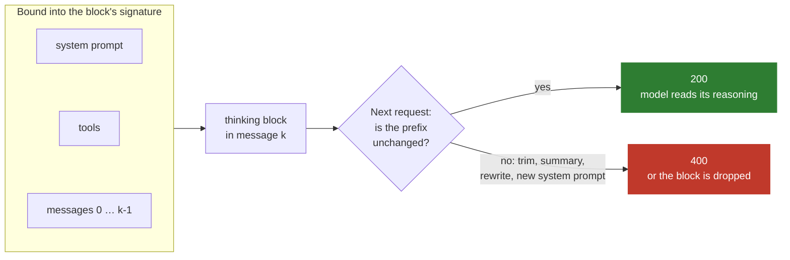
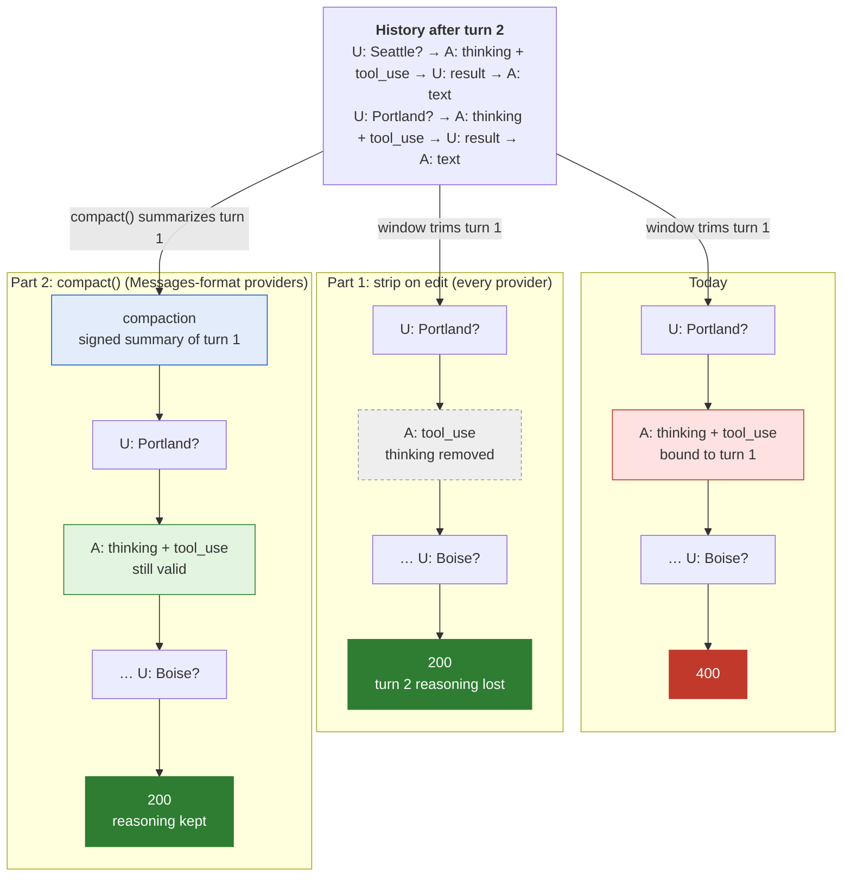
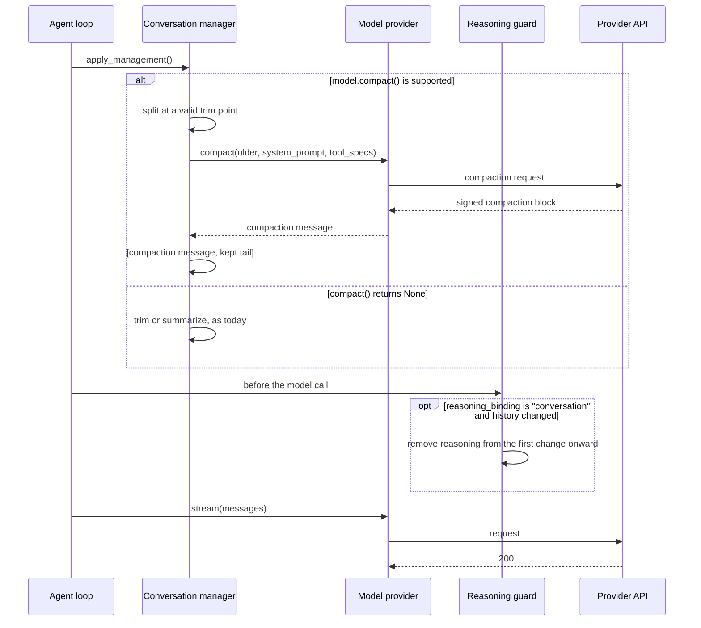

# Preserved Thinking Compatibility

**Date**: 2026-10-12

**Issue**: [#4933](https://github.com/strands-agents/harness-sdk/issues/4933)

**Scope**: Both SDKs. Part 1 ships first and stands alone; part 2 lands per provider, starting with `AnthropicModel`.

**Related**: Builds on design 0019, model-side compaction ([#4742](https://github.com/strands-agents/harness-sdk/pull/4742), implementation [#4752](https://github.com/strands-agents/harness-sdk/pull/4752)).

## Overview

Claude Opus 5.5, Claude Sonnet 5.5, and Claude Fable 5.1 bind each thinking block to the conversation that produced it. Any edit to an earlier turn, the system prompt, or the tool list invalidates every later thinking block, and replaying one is a 400. Every built-in Strands conversation manager edits history, so long-running agents on these models fail mid-session.

This proposal has two parts. Part 1 strips invalidated reasoning at the edit point, which makes history edits safe on every provider. Part 2 adds `Model.compact()`, so providers that support server-side compaction keep the reasoning instead. Part 2 introduces a new public `compaction` content block in both SDKs.

## Goals and non-goals

**Goals:**
- Trimming, summarizing, or truncating history no longer fails with a 400 on these models, on any provider.
- Keep reasoning across edits wherever the provider supports server-side compaction.
- Existing agents keep working with no code or configuration change.

**Non-goals:**
- Mid-conversation system messages and `tool_addition` / `tool_removal` blocks ([Future work](#future-work)).
- `compact()` for providers other than Anthropic.

## Problem

A *thinking block* is the API's wire type; Strands stores the same content as a *reasoning* content block (`reasoningContent` / `ReasoningBlock`). Each thinking block's signature records the `system` prompt, the `tools`, and every message before it. When the history comes back, the API checks that this prefix is unchanged, and rejects the request if it isn't. Retrying the same body fails the same way.

Anthropic runs the check wherever Claude is served: the Claude API, Amazon Bedrock (Converse and InvokeModel), and Google Cloud. It is on by default for accounts created on or after 2026-08-31, and older accounts opt in by setting `thinking.block_binding.prefix_mismatch_behavior`. There is no documented way to turn it off.

Strands users hit this when a conversation manager trims or summarizes, or when they change `agent.system_prompt` or the tools between invocations. Library authors on older accounts can ship code that works for them and fails for their users on new accounts.

### Current state

Each thinking block is bound to everything sent before it:



Strands treats `agent.messages` as freely editable. Each built-in edit against `global.anthropic.claude-opus-5-5` was reproduced through both Bedrock Converse (`BedrockModel`) and Bedrock InvokeModel (see appendix for test script):

| Strands behavior | Result |
|---|---|
| Append-only history | 200 |
| `SlidingWindowConversationManager` trims old turns | 400, "content that preceded this block … is missing, starting at `messages.0`" |
| `SummarizingConversationManager` summarizes and keeps a tail | 400, "content before this block was rewritten" |
| `agent.system_prompt` changed between turns | 400, "the `system` prompt differs" |
| Tool result truncated in place (`_truncate_tool_results`, offload strategies) | 400, "content before this block differs" |

```
ValidationException ... ConverseStream ... messages.1.content.0: Invalid `signature` in `thinking` block.
The block is bound to a different conversation. Remove the block, or set
`thinking.block_binding.prefix_mismatch_behavior` to "drop_block".
```

`SlidingWindowConversationManager` is the default, so any agent on these models that outgrows its window fails. The `_context_manager` paths (the `auto` preset, the `summarize_context` tool, and the offload strategies) and the TypeScript managers make the same edits. Only eager truncation in `auto` is safe, because it runs before the model sees the content.

## Proposal

Every Strands edit has a replacement that works on these models. What differs is whether reasoning survives, and where the replacement runs:

| Strands feature | Works everywhere (loses reasoning) | Native API replacement (keeps reasoning) | Where the native one runs |
|---|---|---|---|
| `SlidingWindowConversationManager` | Trim, then strip reasoning from the kept messages | On-demand compaction (`compact-2026-09-04`) | Claude API, Bedrock InvokeModel, Google Cloud, Microsoft Foundry; not Bedrock Converse |
| `SummarizingConversationManager` | Strip reasoning from the kept tail | On-demand compaction, keeping recent turns | Same as above |
| Tool result truncation / offload | Strip reasoning from the edited message onward | `clear_tool_uses_20250919` context editing | Claude API, Bedrock InvokeModel |
| System prompt change | Strip reasoning | Appended `role: "system"` message | Claude API, Bedrock InvokeModel |
| Tool list change | Strip reasoning | `tool_addition` / `tool_removal` blocks (beta) | Claude API, Amazon Bedrock, Google Cloud |

The recommendation uses the left-hand column everywhere, and the right-hand column wherever the provider supports it. What `SlidingWindowConversationManager` sends on turn 3 today, and after each part:



### Recommended: strip on edit, plus server-side compaction where available

**Part 1: strip invalidated reasoning (all providers).** An edit at message *k* invalidates every thinking block after *k* and none before it. The API accepts removing thinking blocks from either end of the history but not leaving a gap, so the SDK removes all reasoning from *k* to the end. A trim, a summary, or a system prompt or tool change is an edit at position 0.

An internal reasoning guard does this before each model call, when `model.reasoning_binding` is `"conversation"`. It diffs the system prompt, tool specs, and messages against the previous request and strips from the first difference, so it also covers user code that edits `agent.messages`. A `compact()` swap is not an edit: when `messages[0]` is an assistant message holding a new `compaction` block from the current provider, the guard takes the history as its new baseline. With no previous request (the first call, or after a session restore), it strips nothing ([open question 2](#open-questions)).

**Part 2: `Model.compact()` (opt-in per provider).** An optional method that sends the older part of the history to the provider's compaction API and returns one assistant message holding a signed `compaction` block, or `None` when unsupported or when no summary was produced. Every reduction path calls it first through one shared helper, which splits at a valid trim point (after a tool result or a finished assistant turn) and puts the compaction message in front of the untouched tail. The tail's thinking stays valid as long as the system prompt and tools match the compaction request. On `None`, the path falls back to its current behavior, and part 1 strips the tail.



**Pros:**
- Part 1 fixes every failure on every provider, Bedrock Converse included, with no change for users.
- Part 2 is Anthropic's recommended way to compact, and keeps the reasoning part 1 discards.
- Nothing in the agent loop or conversation managers is Anthropic-specific.

**Cons:**
- Part 1 discards reasoning at every edit, which costs extra output tokens and resets the prompt cache from the edit point.
- Bedrock Converse rejects compaction, so `BedrockModel` users get part 1 only until it has an InvokeModel transport.
- The `compaction` block is a new public type touching serialization, session persistence, streaming, and everything that walks content blocks. Its cost is reported only in `usage.iterations`.

### Interface

Two additions to `Model`, one config key, and one content block. `compact()` summarizes exactly the messages it is given; the caller owns the split and the swap into `agent.messages`.

```python
# strands-py/src/strands/models/model.py
ReasoningBinding = Literal["none", "model", "conversation"]


class BaseModelConfig(TypedDict, total=False):
    context_window_limit: int | None
    reasoning_binding: ReasoningBinding | None  # overrides the defaults table


class Model(abc.ABC):
    @property
    def reasoning_binding(self) -> ReasoningBinding:
        """Resolved as the reasoning_binding config key > the defaults table by model ID > "none"."""

    async def compact(
        self,
        messages: Messages,
        tool_specs: list[ToolSpec] | None = None,
        system_prompt_content: list[SystemContentBlock] | None = None,
        *,
        instructions: str | None = None,
        **kwargs: Any,
    ) -> Message | None:
        """Return an assistant message holding a compaction block, or None if unsupported or no summary."""
        return None


# strands-py/src/strands/types/content.py
class CompactionContent(TypedDict, total=False):
    text: str        # the readable summary (wire: `content`)
    signature: str   # opaque; must round-trip byte-for-byte
    provider: str    # provider that produced the signature, e.g. "anthropic"
```

```typescript
// strands-ts/src/models/model.ts
export type ReasoningBinding = 'none' | 'model' | 'conversation'

export interface BaseModelConfig {
  contextWindowLimit?: number
  reasoningBinding?: ReasoningBinding
}

export interface CompactOptions {
  systemPrompt?: SystemPrompt
  toolSpecs?: ToolSpec[]
  instructions?: string
  signal?: AbortSignal
}

export abstract class Model<T extends BaseModelConfig = BaseModelConfig> {
  get reasoningBinding(): ReasoningBinding { ... }
  async compact(messages: Message[], options?: CompactOptions): Promise<Message | undefined> {
    return undefined
  }
}

// strands-ts/src/types/messages.ts
export interface CompactionBlockData { text: string; signature?: string; provider?: string }
export class CompactionBlock { readonly type = 'compactionBlock' as const; ... }
```

**Provider contract.** `reasoning_binding` defaults from a table keyed by model ID (`_defaults.py` / `defaults.ts`), like `context_window_limit`; only `"conversation"` turns on the guard. A provider adopts the standard by adding its model IDs to the table and, optionally, implementing `compact()`.

**The `compaction` block** goes through [API bar raising](../API_BAR_RAISING.md). The shared message normalization step rewrites a block from another provider into text ([open question 8](#open-questions)), so no other formatter changes. `AnthropicModel` sends its own blocks verbatim and adds the `compact-2026-09-04` header whenever one is present, which survives session restore with no extra state. Conversation managers and context strategies never trim, summarize, or offload the block, and the next `compact()` replaces it.

### Alternative: carry the summary as a text block plus signature

Design 0019's choice: a `text` block with an extra `signature` key, which `AnthropicModel` sends as a `compaction` block.

- **Pros:** no new public type.
- **Cons:** the type misdescribes the content, and code that merges or rewrites text blocks can silently drop the signature. The guard and pinning rules would special-case "text with a signature". With the normalization step, the new block costs no formatter changes either.

### Alternative: threshold compaction

Let the server compact inside a normal request once input tokens cross a trigger.

- **Pros:** almost no SDK surface, and no extra round trip.
- **Cons:** the trigger can't go below 50,000 tokens, it competes with our own reduction, and it can't be combined with `clear_tool_uses`.

### Alternative: send `drop_block` by default

Set `prefix_mismatch_behavior: "drop_block"`, so the API drops invalid blocks instead of returning a 400.

- **Pros:** a one-line change per provider.
- **Cons:** invalid blocks stay in `agent.messages` forever. Anthropic measured 4.6%–67.1% more output tokens when blocks are dropped every turn, and calls it a stopgap. The drop is silent.

We still send it as a backstop alongside part 1.

### Alternative: handle it inside each provider

Each provider strips or compacts inside its own `stream()` call.

- **Pros:** no new `Model` surface.
- **Cons:** a provider can't see what changed since the last request, and conversation managers can't choose compaction over trimming.

### Alternative: never send reasoning back

Strip all reasoning from every request to an affected model.

- **Pros:** the simplest implementation.
- **Cons:** the model loses its reasoning every turn. Anthropic advises against it except as a one-time recovery.

### Alternative: server-side context management only

Use compaction and context editing where supported, and drop client-side reduction.

- **Pros:** no reasoning is lost where it's supported.
- **Cons:** Bedrock Converse keeps failing, and OpenAI, Gemini, and Ollama users lose any way to shrink a conversation.

## Developer Experience

Existing code keeps working, and part 1 logs what it strips at debug level:

```python
agent = Agent(
    model=BedrockModel(model_id="global.anthropic.claude-opus-5-5"),
    conversation_manager=SlidingWindowConversationManager(window_size=40),
)
agent("Weather in Boise?")  # trimming no longer causes a 400
# edit_index=<0>, removed_reasoning_blocks=<3> | stripped reasoning invalidated by history edit
```

A model not yet in the defaults table opts in through config:

```python
model = BedrockModel(model_id="us.anthropic.claude-new-model", reasoning_binding="conversation")
```

A provider implements `compact()` against its own summary API:

```python
class AnthropicModel(Model):
    @override
    async def compact(self, messages, tool_specs=None, system_prompt_content=None, *, instructions=None, **kwargs):
        response = await self.client.beta.messages.create(
            **self.format_request(messages, tool_specs, system_prompt_content=system_prompt_content),
            betas=["compact-2026-09-04"],
            compaction={"type": "summarize", **({"instructions": instructions} if instructions else {})},
        )
        block = next((block for block in response.content if block.type == "compaction"), None)
        if block is None:  # max_tokens, refusal, or a dangling tool call: no summary
            return None
        compaction = {"text": block.content, "signature": block.signature, "provider": "anthropic"}
        return {"role": "assistant", "content": [{"compaction": compaction}]}
```

Every reduction path goes through one shared helper. It calls `agent.model`, not `agent.aux_model`, because the block is signed for the model that continues the conversation:

```python
async def compact_or_summarize(agent, preserve_recent, instructions=None):
    split = _valid_trim_point(agent.messages, preserve_recent)  # after a tool result or a finished assistant turn
    older, tail = agent.messages[:split], agent.messages[split:]
    summary = await agent.model.compact(
        older,
        agent.tool_registry.get_all_tool_specs(),
        agent._system_prompt_content,
        instructions=instructions,  # from the path's existing summarization config
    )
    if summary is None:
        summary = await _generate_summary(older, agent)  # current behavior; the reasoning guard strips the tail
    agent.messages[:] = [summary, *tail]
```

## Rollout

One PR per step per SDK:

1. **Part 1:** `reasoning_binding`, defaults for the three models, the reasoning guard, and the `drop_block` backstop. This alone fixes every 400 above.
2. **The `compaction` block** and the normalization step, after API bar raising.
3. **`Model.compact()`**, `AnthropicModel`, the shared helper, and a `compaction_iterations` usage metric. Builds on [#4752](https://github.com/strands-agents/harness-sdk/pull/4752), swapping its signed text block for the `compaction` block.

## Verification

- Guard unit tests: append-only strips nothing, an edit at *k* strips from *k* only, a `compact()` swap strips nothing, and `reasoning_binding="none"` is untouched.
- Every [reproduction scenario](#appendix-reproduction-snippets) returns 200 in both SDKs; today four return 400.
- After compaction, the next request keeps the tail's thinking and returns 200, as the API already does on Bedrock InvokeModel ([snippet](#native-messages-api-bedrock-invokemodel)). When `compact()` returns `None`, the fallback also returns 200.

## Open questions

1. Should `compact()` live on `Model` or a separate capability protocol, and should `Model` also expose `supports_compaction` (as 0019 proposes)?
2. Should the guard compare against what was sent, or against an append-only log kept by the agent? The log also survives session restore.
3. Does Bedrock Converse return `input_transformations` anywhere? We have not seen it.
4. Should the `compaction` block use the wire name `content` instead of `text`, and is `signature` optional? The API also returns `encrypted_content` and `tool_changes` (both null in our runs) and rejects fields it didn't return, so the type must round-trip exactly the fields that are set. Should it model the two extra fields now?
5. Is `reasoning_binding` the right name, and does `"model"` earn its place as a value?
6. Should `BedrockModel` gain an InvokeModel transport so Bedrock users get compaction?
7. If Anthropic changes the `compact-2026-09-04` or `thinking-binding-controls-2026-08-01` betas: proposed, `compact()` returns `None` on rejection, so managers fall back to part 1, which uses no beta.
8. How should a foreign `compaction` block render? Proposed: a labeled text block ("Summary of earlier conversation: …"), so the model reads it as context, not as prior turns or instructions.

## Future work

- Mid-conversation system messages and `tool_addition` / `tool_removal` blocks, so instruction and tool changes keep reasoning.
- `clear_tool_uses_20250919` context editing in place of tool result truncation.
- A Bedrock InvokeModel transport ([open question 6](#open-questions)).
- Threshold compaction as an opt-in passive mode.

## Additional Details

<details>
<summary>Platform availability and the reasoning guard</summary>

The [reproduction snippets](#appendix-reproduction-snippets) set `prefix_mismatch_behavior: "error"`, so they reproduce from accounts created before 2026-08-31 too.

### Platform availability

| Feature | Claude API | Bedrock InvokeModel | Bedrock Converse |
|---|---|---|---|
| `block_binding` / `drop_block` | beta | beta | passes through `additionalModelRequestFields` |
| Context editing (`clear_tool_uses`, `clear_thinking`) | beta | beta (`clear_tool_uses` verified) | not supported |
| Threshold compaction (`compact_20260112`, 50K-token minimum trigger) | beta | beta | no `compaction` content type |
| On-demand compaction (`compact-2026-09-04`) | beta | beta (verified) | rejected |
| Mid-conversation system messages | GA | GA (verified) | not supported |

On the Messages API path, two of Anthropic's append-only replacements also passed: an appended `role: "system"` message instead of a system prompt edit, and `clear_tool_uses_20250919` instead of truncating tool results.

On-demand compaction on Bedrock InvokeModel, verified 2026-10-13 (and by 0019 on 2026-09-29):
- The response is an assistant message with one `compaction` block (`content`, `signature`), `stop_reason: "compaction"`, and zero top-level tokens; the cost is in `usage.iterations`.
- `[compaction message, kept tail]` returns 200 with the tail's thinking intact under `prefix_mismatch_behavior: "error"`.
- The same request without the `compact-2026-09-04` header returns 400: `compaction` is an unknown block type.
- The API also accepts the block in a user message; we keep the assistant role it returns.
- Changing the block's text or signature returns `compaction_signature_invalid` or `compaction_content_mismatch` (per 0019).

### Reasoning guard sketch

A hook on `BeforeModelCallEvent`, registered by the agent and not exported:

```python
# strands-py/src/strands/agent/_reasoning_guard.py (internal)
class _ReasoningGuard:
    """Removes reasoning invalidated by history edits before each model call."""

    _last_request: _RequestPrefix | None  # system prompt, tool specs, and messages last sent

    def _on_before_model_call(self, event: BeforeModelCallEvent) -> None:
        if event.agent.model.reasoning_binding != "conversation":
            return
        edit_index = self._first_changed_index(event)  # None if append-only, or if compact() swapped the prefix
        if edit_index is not None:
            removed = _strip_reasoning(event.agent.messages, start=edit_index)
            logger.debug(
                "edit_index=<%s>, removed_reasoning_blocks=<%s> | stripped reasoning invalidated by history edit",
                edit_index,
                removed,
            )
        self._last_request = _RequestPrefix.capture(event)
```

</details>

<details>
<summary>Appendix: reproduction snippets</summary>

### Appendix: reproduction snippets

There are two scripts. The Strands one reproduces each failure through `BedrockModel` (Bedrock Converse). The native one exercises Anthropic's append-only replacements through the Messages API on Bedrock InvokeModel. Both set `prefix_mismatch_behavior: "error"`, so results are the same on any account age.

#### How to run

Set up a virtualenv in `strands-py/` with the SDK and the Anthropic client:

```bash
cd strands-py
uv venv && source .venv/bin/activate
uv pip install -e . "anthropic[bedrock]"
```

Both scripts call `global.anthropic.claude-opus-5-5` in `us-west-2` with your default AWS credentials (set `AWS_PROFILE` if needed), and cost a few cents per scenario.

| Script | Saved as | Run with | Expected |
|---|---|---|---|
| Strands | `strands-py/src/test_preserved_thinking.py` | `python -i test_preserved_thinking.py` from `strands-py/src`, then paste each scenario | The baseline and `drop_block` scenarios return; the other four raise the 400 shown in their comments |
| Native | `strands-py/src/test_preserved_thinking_anthropic.py` | `python test_preserved_thinking_anthropic.py` from `strands-py/src` | Runs top to bottom: prints the applied context edits and `compaction`, then ends with the expected 400 from the last scenario |

Thinking is adaptive, so the model sometimes skips it on a short turn. If no thinking block ends up in the history, an edit has nothing to invalidate and the scenario passes; re-run it.

#### Strands (`BedrockModel`, Converse)

`make_agent()` builds an agent with binding enforcement opted in:

```python
import json

from strands import Agent, tool
from strands.agent.conversation_manager import (
    NullConversationManager,
    SlidingWindowConversationManager,
    SummarizingConversationManager,
)
from strands.models import BedrockModel


@tool
def get_weather(city: str) -> str:
    """Get the current weather for a city.

    Args:
        city: City name.
    """
    return json.dumps({"city": city, "temp_f": 61, "conditions": "overcast"})


def make_agent(conversation_manager=None, mismatch_behavior="error"):
    model = BedrockModel(
        model_id="global.anthropic.claude-opus-5-5",
        region_name="us-west-2",
        max_tokens=8000,
        additional_request_fields={
            # Setting the field (any value) opts accounts created before 2026-08-31 into enforcement.
            "thinking": {"type": "adaptive", "block_binding": {"prefix_mismatch_behavior": mismatch_behavior}},
            "anthropic_beta": ["thinking-binding-controls-2026-08-01"],
        },
    )
    return Agent(
        model=model,
        tools=[get_weather],
        system_prompt="You are a terse weather assistant. Always use the get_weather tool.",
        conversation_manager=conversation_manager or NullConversationManager(),
        callback_handler=None,
    )
```

Each scenario runs two turns, edits the history, then runs a third turn:

```python
# Baseline: append-only history -> 200
agent = make_agent()
agent("Weather in Seattle?"); agent("And Portland?"); agent("And Boise?")

# SlidingWindowConversationManager trims turn 1 -> 400
# "Content that preceded this block ... is missing, starting at `messages.0`"
agent = make_agent(SlidingWindowConversationManager(window_size=4))
agent("Weather in Seattle?"); agent("And Portland?"); agent("And Boise?")

# SummarizingConversationManager summarizes and keeps a tail -> 400
# "Content before this block was rewritten since it was created"
agent = make_agent(SummarizingConversationManager(summary_ratio=0.5, preserve_recent_messages=4))
agent("Weather in Seattle?"); agent("And Portland?")
agent.conversation_manager.reduce_context(agent)
agent("And Boise?")

# System prompt changed between turns -> 400
# "The `system` prompt differs from the one this block was created with"
agent = make_agent()
agent("Weather in Seattle?"); agent("And Portland?")
agent.system_prompt += " Answer in Celsius."
agent("And Boise?")

# Earlier tool result rewritten in place -> 400
# "Content before this block differs from when it was created"
agent = make_agent()
agent("Weather in Seattle?"); agent("And Portland?")
first_result = next(b for m in agent.messages for b in m["content"] if "toolResult" in b)
first_result["toolResult"]["content"] = [{"text": "[truncated]"}]
agent("And Boise?")

# Same trim as the sliding window, with drop_block -> 200 (reasoning dropped)
agent = make_agent(SlidingWindowConversationManager(window_size=4), mismatch_behavior="drop_block")
agent("Weather in Seattle?"); agent("And Portland?"); agent("And Boise?")
```

#### Native Messages API (Bedrock InvokeModel)

`make_chat()` returns a conversation that is called like a Strands agent, so each scenario mirrors the Strands ones. `chat.compact()` replaces everything before the last turn with a server-signed compaction block, and the compact beta header is added whenever one is in the history.

```python
import json

from anthropic import AnthropicBedrock

client = AnthropicBedrock(aws_region="us-west-2")  # uses AWS_PROFILE / default credentials
MODEL = "global.anthropic.claude-opus-5-5"
SYSTEM = "You are a terse weather assistant. Always use the get_weather tool."
TOOLS = [
    {
        "name": "get_weather",
        "description": "Get the current weather for a city.",
        "input_schema": {"type": "object", "properties": {"city": {"type": "string"}}, "required": ["city"]},
    }
]
BINDING_BETA = "thinking-binding-controls-2026-08-01"
CONTEXT_BETA = "context-management-2025-06-27"
COMPACT_BETA = "compact-2026-09-04"
CLEAR_TOOL_USES = {
    "edits": [{"type": "clear_tool_uses_20250919",
               "trigger": {"type": "tool_uses", "value": 2},
               "keep": {"type": "tool_uses", "value": 1}}]
}


class Chat:
    """A Messages API conversation through Bedrock InvokeModel, called like a Strands agent."""

    def __init__(self, context_management=None, compact_header=True):
        self.messages = []
        self.context_management = context_management
        self.compact_header = compact_header

    def __call__(self, prompt, system_note=None):
        """Run one user turn, including its tool loop."""
        self.messages.append({"role": "user", "content": prompt})
        if system_note:
            self.messages.append({"role": "system", "content": system_note})
        while True:
            response = self._create(self.messages)
            self.messages.append({"role": "assistant", "content": [b.to_dict() for b in response.content]})
            if response.stop_reason != "tool_use":
                return response
            self.messages.append({"role": "user", "content": [
                {"type": "tool_result", "tool_use_id": b.id,
                 "content": json.dumps({"city": b.input["city"], "temp_f": 61, "conditions": "overcast"})}
                for b in response.content if b.type == "tool_use"
            ]})

    def compact(self):
        """Replace everything before the last turn with a server-signed compaction block."""
        split = max(i for i, m in enumerate(self.messages) if isinstance(m["content"], str))
        older, tail = self.messages[:split], self.messages[split:]
        response = self._create(older, compaction={"type": "summarize"})
        block = next(b for b in response.model_dump()["content"] if b["type"] == "compaction")
        compaction = {"type": "compaction", "content": block["content"], "signature": block["signature"]}
        self.messages = [{"role": "assistant", "content": [compaction]}, *tail]
        return response

    def _create(self, messages, compaction=None):
        betas = [BINDING_BETA]
        extra = {}
        if self.context_management:
            betas.append(CONTEXT_BETA)
            extra["context_management"] = self.context_management
        if compaction or (self.compact_header and self._has_compaction(messages)):
            betas.append(COMPACT_BETA)
        if compaction:
            extra["extra_body"] = {"compaction": compaction}
        return client.beta.messages.create(
            model=MODEL,
            max_tokens=8000,
            betas=betas,
            system=SYSTEM,
            tools=TOOLS,
            thinking={"type": "adaptive", "block_binding": {"prefix_mismatch_behavior": "error"}},
            messages=messages,
            **extra,
        )

    @staticmethod
    def _has_compaction(messages):
        return any(
            isinstance(m["content"], list) and any(b.get("type") == "compaction" for b in m["content"])
            for m in messages
        )


def make_chat(context_management=None, compact_header=True):
    return Chat(context_management, compact_header)


# Mid-conversation system message instead of editing the system prompt -> 200
chat = make_chat()
chat("Weather in Seattle?"); chat("And Portland?")
chat("And Boise?", system_note="Answer in Celsius from now on.")

# Context editing instead of truncating tool results -> 200, with cleared_tool_uses > 0
chat = make_chat(context_management=CLEAR_TOOL_USES)
chat("Weather in Seattle?"); chat("And Portland?")
print(chat("And Boise?").context_management.applied_edits)

# On-demand compaction instead of summarizing -> 200, the kept turn's thinking still valid
chat = make_chat()
chat("Weather in Seattle?"); chat("And Portland?")
print(chat.compact().stop_reason)  # compaction
chat("And Boise?")

# Same compaction, without the compact beta header -> 400
# "Input tag 'compaction' found using 'type' does not match any of the expected tags"
chat = make_chat(compact_header=False)
chat("Weather in Seattle?"); chat("And Portland?")
chat.compact()
chat("And Boise?")
```

</details>
