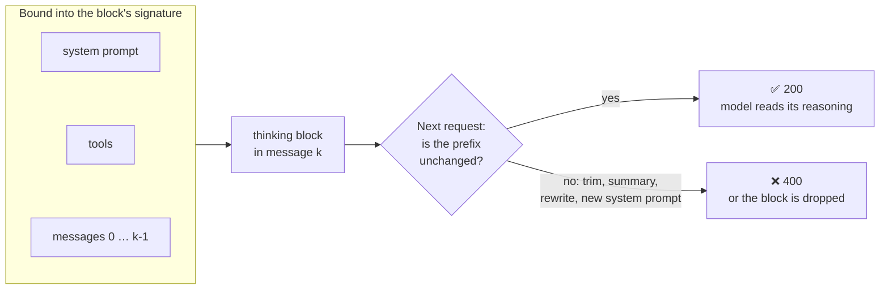
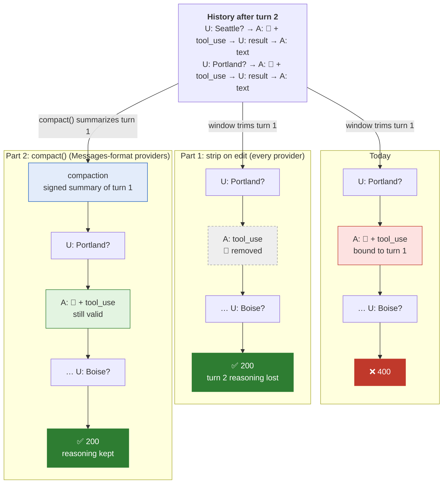
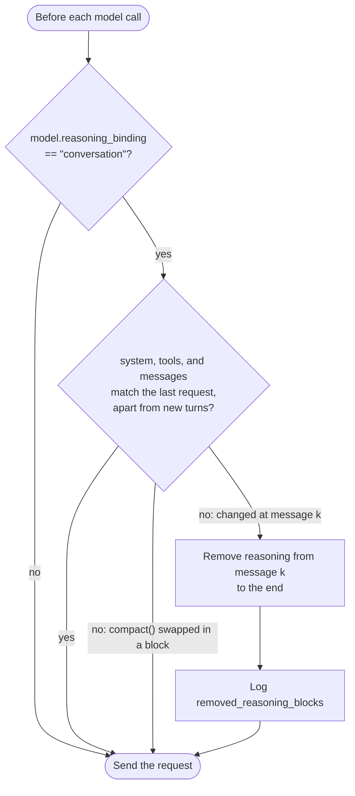

# Preserved Thinking Compatibility

**Date**: 2026-10-12

## Overview

Claude Opus 5.5, Sonnet 5.5, and Fable 5.1 bind each thinking block to the conversation that produced it. Any edit to an earlier turn, the system prompt, or the tool list invalidates every later thinking block, and replaying one is a 400. Every built-in Strands conversation manager edits history, so long-running agents on these models fail mid-session.

This proposal makes Strands' history edits safe on every provider by stripping invalidated reasoning at the edit point, and adds a `Model.compact()` capability so providers that speak the Anthropic Messages API can use server-side compaction and context editing, which keep the reasoning intact. That second part introduces a new public `compaction` content block type in both SDKs.

## Problem

A thinking block's signature records the `system` prompt, the `tools` set, and every message before it. When the history comes back, the API checks that this prefix is unchanged. On a mismatch it rejects the request before any output is produced, and retrying the same body fails the same way.

The check is enforced by default on every platform (Claude API, Amazon Bedrock, Google Cloud) for accounts created on or after 2026-08-31. Older accounts are not enforced yet, but the same request opts in with `thinking.block_binding.prefix_mismatch_behavior`. There is no documented way to turn the check off.

Strands users hit this when an agent runs long enough for its conversation manager to trim or summarize, or when they change `agent.system_prompt` or the tool list between invocations. New AWS and Anthropic accounts are affected first. Tool authors whose users run on new accounts are affected before they notice it themselves.

### Current State

Each thinking block is bound to everything sent before it:



Strands treats `agent.messages` as freely editable. Each built-in edit was reproduced against `global.anthropic.claude-opus-5-5` on Bedrock, through both Converse (`BedrockModel`) and InvokeModel (Anthropic Messages format):

| Strands behavior | Result |
|---|---|
| Append-only history | ✅ 200 |
| `SlidingWindowConversationManager` trims old turns | ❌ 400, "content that preceded this block … is missing, starting at `messages.0`" |
| `SummarizingConversationManager` summarizes and keeps a tail | ❌ 400, "content before this block was rewritten" |
| `agent.system_prompt` changed between turns | ❌ 400, "the `system` prompt differs" |
| Tool result truncated in place (`_truncate_tool_results`, offload strategies) | ❌ 400, "content before this block differs" |

Example error:

```
ValidationException ... ConverseStream ... messages.1.content.0: Invalid `signature` in `thinking` block.
The block is bound to a different conversation. Remove the block, or set
`thinking.block_binding.prefix_mismatch_behavior` to "drop_block".
```

`SlidingWindowConversationManager` is the default. Any agent on these models that outgrows its window fails, and so does any agent whose context-overflow recovery truncates tool results. The `_context_manager` strategies (truncate, summarize, offload) make the same kinds of edits.

The same managers exist in TypeScript (`strands-ts/src/conversation-manager/`), so both SDKs are affected.

## Proposal

Every Strands edit has a replacement that works on these models. What differs is whether reasoning survives, and where the replacement runs:

| Strands feature | Works on Converse today (loses reasoning) | Native API replacement (keeps reasoning) | Where the native one runs |
|---|---|---|---|
| `SlidingWindowConversationManager` | Trim, then strip thinking from the kept messages | On-demand compaction (`compact-2026-09-04`) | Claude API, Claude Platform on AWS, Google Cloud, Microsoft Foundry; not Bedrock |
| `SummarizingConversationManager` | Summary replaces the whole history, or strip thinking from the kept tail | On-demand compaction, keeping recent turns | Same as above |
| Tool result truncation / offload | Strip thinking from the edited message onward | `clear_tool_uses_20250919` context editing | Claude API; Bedrock InvokeModel (verified) |
| System prompt change | Strip thinking, or `drop_block` | Appended `role: "system"` message | Claude API; Bedrock InvokeModel (verified) |
| Tool list change | Strip thinking, or `drop_block` | `tool_addition` / `tool_removal` blocks (beta) | Claude API, Bedrock, Google Cloud |

The recommendation uses the left-hand column everywhere, and the right-hand column wherever the provider supports it.

What `SlidingWindowConversationManager` sends on turn 3 today, and after each part of the fix (🧠 marks a thinking block):



`SummarizingConversationManager` follows the same pattern. Today its kept tail fails like the sliding window above. Part 1 strips the tail's reasoning. Part 2 keeps the tail's reasoning valid through on-demand compaction's "keep recent turns" option.

### Recommended: strip on edit, plus server-side compaction where available

There are two parts. The first ships on its own and fixes the failures. The second keeps the reasoning that the first part discards.

**1. Strip invalidated reasoning at the edit point (all providers).** An edit at message *k* invalidates every thinking block after *k*. Blocks before *k* were created before the edited content existed, so they stay valid. The API accepts removing thinking blocks from the start of the history, from the end, or all of them; what it rejects is a gap. So when history changes, the SDK removes every `reasoningContent` / `ReasoningBlock` from the first changed message to the end, and keeps the rest:

- A trim from the front (sliding window) or a summary of the front changes position 0, so every remaining block goes.
- A rewrite of one tool result in the middle keeps the reasoning before that tool result.
- A change to the system prompt or the tools counts as a change at position 0.

Reasoning produced after the edit is valid, because the history is append-only from that point on.

This logic lives in one shared helper, not in each manager. The helper runs before each model call. It compares the system prompt, the tool specs, and the messages with what was sent on the previous call, and strips reasoning from the first difference onward. That way it also covers user code that edits `agent.messages` or `agent.system_prompt` directly. A swap done by `compact()` is the one exception: the server already accounts for it (see part 2), so the helper leaves those blocks alone.



It applies only to models whose `reasoning_binding` is `"conversation"`; see [Provider contract](#provider-contract). Other models are untouched.

**2. `Model.compact()` for providers with server-side compaction (opt-in per provider).** Add an optional method to the model interface:

```python
async def compact(self, messages: Messages, system_prompt: ..., tool_specs: ...) -> Messages | None
```

The default returns `None`, meaning not supported. A provider that implements it calls Anthropic's on-demand compaction (`compaction: {"type": "summarize"}`, beta `compact-2026-09-04`) and returns a history that starts with a signed `compaction` block. Recent turns can be kept word for word, with their thinking still valid. `SummarizingConversationManager` and `SlidingWindowConversationManager` call `model.compact()` first and fall back to their current behavior, plus part 1, when it returns `None`.

How a model call flows once both parts are in place:

```mermaid
sequenceDiagram
    participant Loop as Agent loop
    participant CM as Conversation manager
    participant M as Model provider
    participant G as Strip-on-edit helper
    participant API as Provider API

    Loop->>CM: apply_management()
    alt model.compact() is supported
        CM->>M: compact(messages, system, tools)
        M->>API: compaction request
        API-->>M: signed compaction block
        M-->>CM: [compaction, recent turns]
    else compact() returns None
        CM->>CM: trim or summarize, as today
    end
    Loop->>G: before the model call
    G->>G: diff system, tools, messages against the last request
    opt reasoning_binding is "conversation" and history changed
        G->>G: remove reasoning from the first change onward
    end
    Loop->>M: stream(messages)
    M->>API: request
    API-->>M: ✅ 200
```

Part 2 depends on a new public content block type; see the next section.

**Pros:**
- Part 1 fixes every failure on every provider, Converse included, with no API change for users.
- Part 2 is how Anthropic recommends compacting on these models, and it keeps the reasoning that part 1 discards.
- The conversation managers keep their names and configuration. The obvious path keeps working.
- Nothing in the agent loop or the conversation managers is specific to Anthropic. Another provider adopts the standard by declaring capabilities, not by changing core code.

**Cons:**
- Part 1 throws away reasoning at every edit. The model re-plans, which costs extra output tokens and resets the prompt cache from the edit point.
- On-demand compaction is not available on Amazon Bedrock yet. Bedrock users get part 1 only until it is.
- The new `compaction` block is a public type in both SDKs. It touches serialization, session persistence, streaming, every provider's formatter, and every component that walks content blocks.

### New public type: the `compaction` content block

A compacted history starts with a signed summary. It is neither text nor reasoning. The API rejects it if it is changed, re-encoded, or sent with extra fields, so it needs its own content block type in both SDKs. This is a new public type, so it goes through [API bar raising](../API_BAR_RAISING.md).

```python
# strands-py/src/strands/types/content.py
class CompactionContent(TypedDict, total=False):
    text: str        # the readable summary (wire: `content`)
    signature: str   # opaque; must round-trip byte-for-byte
    provider: str    # provider that produced the signature, e.g. "anthropic"

class ContentBlock(TypedDict, total=False):
    ...
    compaction: CompactionContent
```

```typescript
// strands-ts/src/types/messages.ts
export interface CompactionBlockData { text: string; signature?: string; provider?: string }
export type ContentBlockData = ... | { compaction: CompactionBlockData }
export class CompactionBlock { readonly type = 'compactionBlock' as const; ... }
```

Where the type has to be handled:

- **Types and serialization.** Add it to the `ContentBlock` unions in both SDKs, to TS JSON (de)serialization, and to session persistence, so a restored session sends the block back exactly as it was received.
- **Streaming.** Parse the `compaction` content block start event in the Anthropic providers, and emit it through the event loop as a completed block.
- **Model providers.** A provider sends the block verbatim only when `provider` matches its own; Anthropic puts it first in `messages`, with the beta header on every request that carries it. Every other provider renders `text` as a plain user message, so the context survives a switch to another model.
- **Conversation managers and context strategies.** Treat the block as pinned: never trim, summarize, or offload it. Calling `compact()` again replaces it with a new one.
- **Everything else that walks content blocks** (tracer, memory extraction, the stash, offload strategies, bidi) handles the new type explicitly or skips it.

### Provider contract

Anthropic is first, but conversation-bound reasoning and signed summaries are not Anthropic-specific ideas, and other providers may adopt them. Nothing in the agent loop or the conversation managers checks the provider. They read two capabilities from `Model`, each defaulting to "not supported". This follows the existing `stateful` property and the `context_window_limit` defaults table.

| Capability | Values | Default | What the SDK does with it |
|---|---|---|---|
| `reasoning_binding` | `"none"`, `"model"`, `"conversation"` | Looked up by model ID in `_defaults.py` / `defaults.ts`, else `"none"` | `"conversation"` turns on strip-on-edit (part 1). `"model"` needs nothing from the SDK, because the API drops what the target model can't read. |
| `compact()` | returns `Messages` starting with a `compaction` block, or `None` | `None` | Conversation managers call it before falling back to client-side trimming or summarizing (part 2). |

`reasoning_binding` is also a model config key, like `context_window_limit`. A user can opt a model in the day it launches, without waiting for a Strands release:

```python
OpenAIModel(model_id="some-new-model", reasoning_binding="conversation")
```

When a provider adopts the standard, its author does up to three things:

1. Add its model IDs to the defaults table with `"conversation"`.
2. Optionally, implement `compact()` against the provider's own server-side summary API, setting `provider` on the returned block.
3. In its formatter, send its own `compaction` blocks verbatim and render other providers' blocks as text.

Provider-specific knobs stay in that provider's config, for example Anthropic's `block_binding` / `drop_block` and its beta headers. Each provider's own mismatch handling is not part of the shared contract.

### Alternative: send `drop_block` by default

Set `thinking.block_binding.prefix_mismatch_behavior: "drop_block"` (beta `thinking-binding-controls-2026-08-01`) on every request for affected models. The API then drops invalid blocks instead of returning a 400. This was verified to pass through `additionalModelRequestFields` on Converse.

- **Pros:** a one-line change per provider, and no SDK history logic.
- **Cons:**
  - The invalid blocks stay in `agent.messages` forever, so every later request depends on the flag.
  - Anthropic measured 4.6%–67.1% more output tokens when blocks are dropped on every turn, and calls it a stopgap.
  - The drop happens without telling the caller. `input_transformations` was not returned on the paths we tested.
  - It only works with providers that pass the field through.

This is still worth sending as a backstop alongside part 1. It is not a fix on its own.

### Alternative: handle it inside each provider

Each provider detects its own affected models and strips or compacts inside its `stream()` call, with no shared capability.

- **Pros:** no new `Model` surface, and changes stay local to each provider.
- **Cons:**
  - A provider can't see what changed since the last request, because the conversation managers make the edits, not the provider.
  - Every provider that adopts the standard re-implements prefix tracking.
  - Conversation managers can't choose server-side compaction over trimming.

### Alternative: never send thinking back

Strip all reasoning from every request to an affected model.

- **Pros:** simplest possible implementation, and the check has nothing to reject.
- **Cons:** the model loses its reasoning on every turn, including the between-turn reasoning that tool loops depend on. Anthropic advises against it except as a one-time recovery.

### Alternative: server-side context management only

Make the Messages-format providers support compaction, context editing, and mid-conversation system messages, and leave other providers unchanged.

- **Pros:** no reasoning is lost on the providers that support it.
- **Cons:** Bedrock Converse, the most common Strands path, can't carry `compaction` blocks or mid-conversation system messages, so it keeps failing.

## Developer Experience

Existing code keeps working without changes:

```python
agent = Agent(
    model=BedrockModel(model_id="global.anthropic.claude-opus-5-5"),
    conversation_manager=SlidingWindowConversationManager(window_size=40),
)
agent("...")  # trimming no longer causes a 400
```

When part 1 strips reasoning, it logs:

```
edit_index=<0>, removed_reasoning_blocks=<3> | stripped reasoning invalidated by history edit
```

With a provider that implements `compact()`, the same manager compacts on the server instead of trimming, and the reasoning in recent turns is kept:

```python
agent = Agent(
    model=AnthropicModel(model_id="claude-opus-5-5", ...),
    conversation_manager=SummarizingConversationManager(preserve_recent_messages=10),
)
```

Users who need to change instructions mid-session should append a mid-conversation system message instead of assigning `agent.system_prompt`. Exposing that is follow-up work for the Messages-format providers, and is out of scope here.

## Additional Details

<details>
<summary>Reproduction, platform availability, and open questions</summary>

### Reproduction

The snippets in [Appendix: reproduction snippets](#appendix-reproduction-snippets) reproduce every result above. They set `prefix_mismatch_behavior: "error"`, so they reproduce from accounts created before 2026-08-31 too.

On the Messages API path, two of Anthropic's append-only replacements also passed:
- an appended `role: "system"` message instead of a system prompt edit;
- `clear_tool_uses_20250919` context editing instead of truncating tool results.

### Platform availability

| Feature | Claude API | Bedrock InvokeModel | Bedrock Converse |
|---|---|---|---|
| `block_binding` / `drop_block` | beta | beta | passes through `additionalModelRequestFields` |
| Context editing (`clear_tool_uses`, `clear_thinking`) | beta | beta (`clear_tool_uses` verified) | not supported |
| Threshold compaction (`compact_20260112`, 50K-token minimum trigger) | beta | beta | no `compaction` content type |
| On-demand compaction (`compact-2026-09-04`) | beta | not available | not available |
| Mid-conversation system messages | GA | GA (verified) | not supported |

### Open questions

1. Should `compact()` live on the model interface, or on a separate capability protocol that providers opt into?
2. Should part 1 compare prefixes against what was actually sent, or against an append-only log kept by the agent? The second also survives session restore.
3. Does Bedrock Converse return `input_transformations` anywhere? We have not seen it.
4. Should the `compaction` block keep the wire field name `content` instead of `text`? Is `signature` optional, since the threshold compaction examples don't show one?
5. Is `reasoning_binding` the right name, and does `"model"` earn its place as a value? Today it changes nothing in the SDK, but it records the fact for routing and fallback code.
6. When will on-demand compaction reach Bedrock? Should we add a Messages-format Bedrock provider (InvokeModel) to get context editing in the meantime?

</details>

<details>
<summary>Appendix: reproduction snippets</summary>

### Appendix: reproduction snippets

These run against Bedrock with AWS credentials (`AWS_PROFILE`) and cost a few cents per scenario. Thinking is adaptive, so the model sometimes skips it on a short turn. If no thinking block ends up in the history, an edit has nothing to invalidate and the scenario passes; re-run it.

#### Strands (`BedrockModel`, Converse)

Run from the repo root with `PYTHONPATH=strands-py/src .venv/bin/python <file>`.

```python
import json

from strands import Agent, tool
from strands.agent.conversation_manager import (
    NullConversationManager,
    SlidingWindowConversationManager,
    SummarizingConversationManager,
)
from strands.models import BedrockModel


@tool
def get_weather(city: str) -> str:
    """Get the current weather for a city.

    Args:
        city: City name.
    """
    return json.dumps({"city": city, "temp_f": 61, "conditions": "overcast"})


def make_agent(conversation_manager=None, mismatch_behavior="error"):
    model = BedrockModel(
        model_id="global.anthropic.claude-opus-5-5",
        region_name="us-west-2",
        max_tokens=8000,
        additional_request_fields={
            # Setting the field (any value) opts accounts created before 2026-08-31 into enforcement.
            "thinking": {"type": "adaptive", "block_binding": {"prefix_mismatch_behavior": mismatch_behavior}},
            "anthropic_beta": ["thinking-binding-controls-2026-08-01"],
        },
    )
    return Agent(
        model=model,
        tools=[get_weather],
        system_prompt="You are a terse weather assistant. Always use the get_weather tool.",
        conversation_manager=conversation_manager or NullConversationManager(),
        callback_handler=None,
    )
```

Each scenario runs two turns, edits the history, then runs a third turn:

```python
# Baseline: append-only history -> 200
agent = make_agent()
agent("Weather in Seattle?"); agent("And Portland?"); agent("And Boise?")

# SlidingWindowConversationManager trims turn 1 -> 400
# "Content that preceded this block ... is missing, starting at `messages.0`"
agent = make_agent(SlidingWindowConversationManager(window_size=4))
agent("Weather in Seattle?"); agent("And Portland?"); agent("And Boise?")

# SummarizingConversationManager summarizes and keeps a tail -> 400
# "Content before this block was rewritten since it was created"
agent = make_agent(SummarizingConversationManager(summary_ratio=0.5, preserve_recent_messages=4))
agent("Weather in Seattle?"); agent("And Portland?")
agent.conversation_manager.reduce_context(agent)
agent("And Boise?")

# System prompt changed between turns -> 400
# "The `system` prompt differs from the one this block was created with"
agent = make_agent()
agent("Weather in Seattle?"); agent("And Portland?")
agent.system_prompt += " Answer in Celsius."
agent("And Boise?")

# Earlier tool result rewritten in place -> 400
# "Content before this block differs from when it was created"
agent = make_agent()
agent("Weather in Seattle?"); agent("And Portland?")
first_result = next(b for m in agent.messages for b in m["content"] if "toolResult" in b)
first_result["toolResult"]["content"] = [{"text": "[truncated]"}]
agent("And Boise?")

# Same trim as the sliding window, with drop_block -> 200 (reasoning dropped)
agent = make_agent(SlidingWindowConversationManager(window_size=4), mismatch_behavior="drop_block")
agent("Weather in Seattle?"); agent("And Portland?"); agent("And Boise?")
```

#### Native Messages API (Bedrock InvokeModel)

Needs `anthropic[bedrock]` (`uv pip install --python .venv/bin/python "anthropic[bedrock]"`).

```python
import json

from anthropic import AnthropicBedrock

client = AnthropicBedrock(aws_region="us-west-2")  # uses AWS_PROFILE / default credentials
MODEL = "global.anthropic.claude-opus-5-5"
SYSTEM = "You are a terse weather assistant. Always use the get_weather tool."
TOOLS = [
    {
        "name": "get_weather",
        "description": "Get the current weather for a city.",
        "input_schema": {"type": "object", "properties": {"city": {"type": "string"}}, "required": ["city"]},
    }
]


def turn(messages, prompt, system=SYSTEM, betas=(), system_note=None, **extra):
    """Run one user turn, including its tool loop, appending everything to messages."""
    messages.append({"role": "user", "content": prompt})
    if system_note:
        messages.append({"role": "system", "content": system_note})
    while True:
        response = client.beta.messages.create(
            model=MODEL,
            max_tokens=8000,
            betas=["thinking-binding-controls-2026-08-01", *betas],
            system=system,
            tools=TOOLS,
            thinking={"type": "adaptive", "block_binding": {"prefix_mismatch_behavior": "error"}},
            messages=messages,
            **extra,
        )
        messages.append({"role": "assistant", "content": [b.to_dict() for b in response.content]})
        if response.stop_reason != "tool_use":
            return response
        messages.append({"role": "user", "content": [
            {"type": "tool_result", "tool_use_id": b.id,
             "content": json.dumps({"city": b.input["city"], "temp_f": 61, "conditions": "overcast"})}
            for b in response.content if b.type == "tool_use"
        ]})


# Mid-conversation system message instead of editing the system prompt
messages = []
turn(messages, "Weather in Seattle?")
turn(messages, "And Portland?")
turn(messages, "And Boise?", system_note="Answer in Celsius from now on.")  # 200

# Context editing instead of truncating tool results
messages = []
clear = {"edits": [{"type": "clear_tool_uses_20250919",
                    "trigger": {"type": "tool_uses", "value": 2},
                    "keep": {"type": "tool_uses", "value": 1}}]}
for prompt in ["Weather in Seattle?", "And Portland?", "And Boise?"]:
    r = turn(messages, prompt, betas=["context-management-2025-06-27"], context_management=clear)
print(r.context_management.applied_edits)  # 200, with cleared_tool_uses > 0
```

</details>
